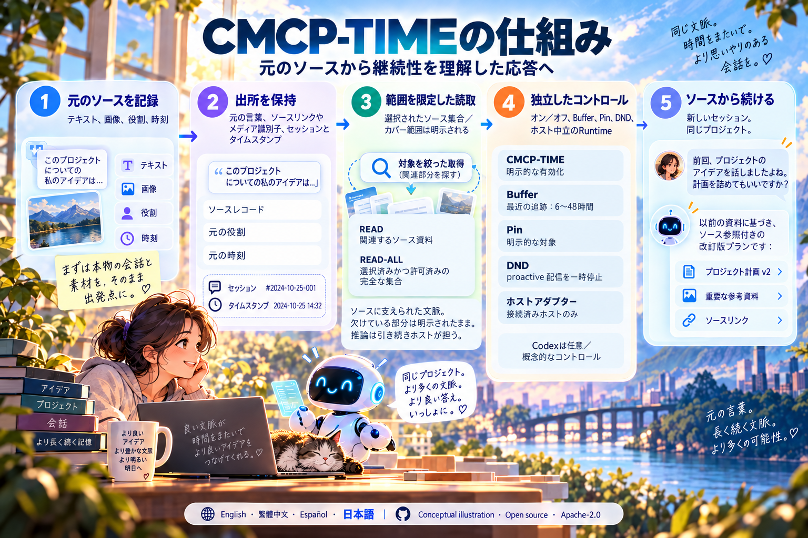
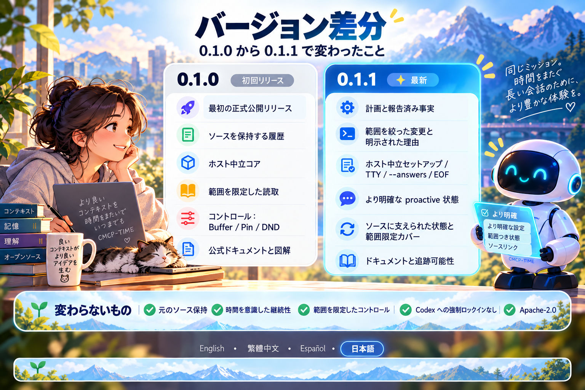

# CMCP-TIME

[English](README.md) · [繁體中文](README.zh-TW.md) · [Español](README.es.md) · **日本語**


## 元の言葉を残し、次の会話に確かめられる出発点を。

**AI アシスタントのための、時間を扱う会話継続スキルです。** CMCP-TIME は、許可された原文、画像、発言者の役割、時刻を保存し、以前の作業を再開するときに必要な資料を渡します。

「何を予定していたか」「どこを変更したか」「何が完了したと報告されたか」も分けて整理できます。**推論は、これまでどおり利用中のモデルが担当します。CMCP-TIME は、確認できる出典、時間情報、制御された引き継ぎの流れを提供します。**

**v0.1.1 · Apache-2.0 · 開発・保守：[redwakame](https://github.com/redwakame)**

[使い始める](#使い始める) · [仕組み](#仕組み) · [バージョンの違い](docs/version-comparison.ja.md) · [意見と協力の窓口](#意見と協力の窓口)

*画像は利用イメージであり、実画面やテスト記録ではありません。人物、会話、時刻の例は説明用です。利用できる機能は、本文と各バージョンの資料に記載した範囲です。*

## 一部の変更のために、プロジェクト全体を説明し直さない

昨日、作業計画を決めたとします。今日はこう伝えます。

> 「納期を金曜日に変えてください。予算と、もともとの承認条件はそのままで。」

新しい会話で必要なのは、単に「計画があった」という記憶ではありません。元の条件、今回の変更、まだ有効な条件が必要です。CMCP-TIME は、接続済みのアシスタントが必要に応じて元の資料を読み返せるように設計されています。

これは用途の例であり、回答の正しさを保証するものではありません。モデルは、正しく受け取った原文を誤読することもあります。CMCP は最終回答を後から書き換えません。

| 必要なこと | CMCP-TIME の役割 |
|---|---|
| 当時の発言を探す | 許可された原文、役割、元の時刻、出典の関係を保持します。 |
| 何が変わったかを確かめる | 計画、適用範囲を限定した変更、事実の報告、明示された理由を、出典付きで整理します。 |
| 長い会話や接続済みホスト間で作業を続ける | 出典を絞ってから範囲を限定して読み取り、欠けたページ、権限、未読資料を明示します。 |
| 追跡対象と通知のタイミングを決める | 保存、Buffer、Pin、通知抑制、能動的な送信を別々に制御します。 |

CMCP-TIME はホストの標準メモリと共存できます。完全なチャット製品ではなく、他の製品のメモリより優れていると実証したバージョンでもありません。

## 使い始める

**Node.js 22.16.0 以上**と npm を用意し、永続的なインストール先を選んでください。npm から固定バージョン `0.1.1` を取得します。

```sh
npm install --prefix ./cmcp-0.1.1 @redwakame-skill/cmcp-time@0.1.1
node ./cmcp-0.1.1/node_modules/@redwakame-skill/cmcp-time/bin/cmcp-time.mjs --version
node ./cmcp-0.1.1/node_modules/@redwakame-skill/cmcp-time/bin/cmcp-time.mjs setup --help
```

続いて[設定・更新ガイド](docs/npm-installation.md)に従い、利用を許可したワークスペースを選びます。端末では対話式ウィザード、自動化では `--answers` を使ってください。**対話用の回答をまとめてパイプ入力する方法には対応していません。**

**ファイルをインストールしただけでは、ホストは接続されません。** 私的な会話の取り込み、モデル使用の許可、能動的な送信、日常環境の置き換えは自動実行されません。Codex は任意です。恒久的な接続先を一時的な `npx` キャッシュや、保存期間が確認されていない領域にしないでください。

GitHub と npm の配布物は公開設定や文書が異なる場合があります。実行内容とソースの対応は、それぞれの公開記録で確認してください。同じ版番号でも圧縮ファイルのバイト列が同じとは限らず、`latest` は固定された出典識別子ではありません。

## 仕組み



*図中の「ソースコード」は保存された原文レコードを指し、プログラムのコードではありません。*

| 段階 | 内容 |
|---|---|
| **1. 許可された資料を取得する** | 接続済みホストから、実際の User／Assistant の内容、役割、時刻、対応する画像原本を受け取ります。 |
| **2. 原本と出典の関係を保つ** | モデルの言い換えを原文として扱わず、後から確認するための識別情報と関係を残します。 |
| **3. 今回必要な範囲を読む** | 出典を特定してから正式なインターフェースで読みます。`READ-ALL` は、選択され許可された集合の全ページを意味します。全データベース、上位数件の検索結果、全内容がモデルに届いたという保証ではありません。 |
| **4. 独立した制御を適用する** | 保存、最近の追跡、明示的な目標、通知抑制を分けます。資料を読めることと、外部操作を実行してよいことは別です。 |
| **5. 元のホストで作業を続ける** | 読んだ資料と時間情報を元のモデルへ渡します。必要なときは、出典のある現在の状態を整理し、未確定事項や範囲の限界を残します。 |

**Skill は使い方を説明し、Runtime は保存と読み取りを実行し、Adapter がホストを接続します。** スキルの説明ファイルだけで、あらゆる AI ホストやプラットフォームの会話を自動取得することはできません。イベント、原文、権限の不足は明示します。

## History、Buffer、Pin、通知抑制の違い

| 機能 | 用途と境界 |
|---|---|
| **History** | 許可された原文を保存して後から正式に読み返します。保存済みでも、現在の読み取り資格があるとは限りません。 |
| **Buffer** | 最近の追跡を管理します。標準は 12 時間、6–48 時間で変更可能です。期限切れやクリアで History や独立した Pin は削除されません。 |
| **Pin** | 明示的に選んだ追跡対象です。時刻を指定しなければ、自動的なリマインダーにはなりません。 |
| **DND／通知抑制** | 能動的な送信による割り込みを制御します。**原文の保存を停止するスイッチではありません。** |
| **能動的な送信** | 初期設定は OFF です。出典の許可、送信先、取消、重複排除、時刻の条件が必要です。60 秒という保持設定があっても、毎分の送信を意味しません。 |

接続済みの Harness Desktop では `/cmcp help`、`/cmcp on`、`/cmcp off` と、`/cmcp ui minimized`、`row`、`hidden` を使えます。**画面を隠しても CMCP の停止にはなりません。** これらは当該ホスト用であり、すべてのエージェント共通のスラッシュコマンドではありません。

UI がない場合は既存の CLI、プロジェクト、MCP の入口を使います。[コマンド](docs/commands.md)、[設定](docs/configuration.md)、[操作ガイド](docs/release-readiness.ja.md)を参照してください。

## 検証記録がある入口

次の表は本プロジェクトが記録した範囲です。すべての製品・バージョンに対する互換性保証ではありません。

| 入口 | 記録済みの機能 | 境界 |
|---|---|---|
| **DeepSeek Harness Desktop 0.2.0-rc.2／SDK** | テキスト、画像原本、新しい会話での再読、制御、明示的な Pin。SDK の引き継ぎ記録は別に扱います。 | Desktop と隔離 SDK は別の検証です。常時稼働や携帯端末への配信は保証しません。 |
| **Codex** | Skill／Hook、公式 app-server によるテキスト引き継ぎ、範囲を限定した標準圧縮。 | 明示したプロジェクトとアカウント経路のみ。任意の App 会話を自動取得しません。 |
| **Hermes v2026.9.24／0.21.5** | 公式のヘッドレス・ライフサイクル、標準ツール、Harness SDK との限定的なテキスト引き継ぎ。 | 記録された DeepSeek 経路であり、TUI／GUI 全体の認証ではありません。 |
| **MCP stdio／Streamable HTTP** | 正式な読み取り、メディア handle、権限範囲、取消、永続的なローカルサービス。 | ローカル試験は、遠隔 TLS、公開運用、プラットフォーム審査の完了を意味しません。 |

**Codex は任意ですが、全ホスト対応という意味ではありません。** `0.1.1` は Dots、Muse、Grok Bot の完全なライフサイクル連携を追加していません。[能力・証拠の一覧](docs/interop-capabilities.zh-TW.md)を参照してください。

## 0.1.0 から 0.1.1 への変更



**0.1.0** は、原文・時刻の保存、範囲を限定した読み取り、独立した制御、既存ホストの入口を整えました。**0.1.1** は S1／S1-R1 の累積成果として、計画と事実報告の分離、部分変更の適用範囲と理由の保持を追加し、初期設定、特定の状態整理、能動的な送信の説明、公開物の追跡性を改善しています。

`--answers` は以前から存在します。今回は非対話／EOF 処理と、Codex を使わない設定時の説明を改善しました。全ホストへの新規接続でも、表紙だけの変更でもありません。

[詳しいバージョン比較](docs/version-comparison.ja.md) · [0.1.1 の元の公開説明と制限](docs/release-0.1.1.md) · [0.1.0 の履歴](docs/release-0.1.0.md)

<details>
<summary><strong>公開範囲と既知の制限</strong></summary>

- 構造上の妥当性、出典の整合性、意味の正しさ、実行権限は別です。`ready` は無誤謬の保証ではありません。
- H4 の保守では、新しい Session で指定報告と投影結果の全ページを確認しました。通常の経路は resolution 分岐を通っておらず、そこは 13 項目の固定原文試験で別に確認しています。追加で選んだ r8 はモデルへ届いていません。全選択資料の `READ-ALL` や、元の中間ターンの再現とは呼びません。
- C27 163／236 の容量制限は残っています。古い受領記録 `be087644…` の変更前の本文全体は見つかっていません。成功を装うために制限を消してはいません。
- 0.1.1 の公開工程は Windows／Node 24.18.0 で実行し、最低 Node 22.16.0 の宣言を維持しています。個別の Linux 確認は全ホストの認証ではありません。四言語の文書は四言語での動作認証ではありません。
- ベクトル検索、音声／動画、広範なクラウド同期、複数 writer の同時実行、完全な 24/7 エージェントは、本版で全部提供済みの機能ではありません。

[証拠と制限](docs/verification.md) · [テスト](docs/testing.md) · [プライバシー](docs/privacy.md) · [ロードマップ](docs/roadmap.md)

</details>

## 文書、更新、プロジェクトの履歴

[クイックスタート](docs/quick-start.md) · [インストール・更新](docs/npm-installation.md) · [操作ガイド](docs/release-readiness.ja.md) · [MCP／Hermes](docs/interop.ja.md) · [貢献](CONTRIBUTING.md) · [セキュリティ報告](SECURITY.md)

更新や接続解除の前に、ガイドに従ってバックアップしてください。プログラム、CMCP History、ホストの履歴、認証情報は別に管理します。接続解除は、すべてのデータの削除ではありません。

CMCP-TIME が本プロジェクトの開発主線です。[OpenClaw Continuity](https://github.com/redwakame/openclaw-continuity) と [cmcp](https://github.com/redwakame/cmcp) は過去のコードと各ライセンスを保持しており、そのまま置き換えたり自動移行したりできるという意味ではありません。

## 意見と協力の窓口

開発・保守を行っている **redwakame** です。今後も開発を続けます。実際の利用例、再現できる不具合、連携のアイデア、使用感、協力のご相談をお待ちしています。

**[adarobot666@gmail.com](mailto:adarobot666@gmail.com)**  
**[redwakame616@gmail.com](mailto:redwakame616@gmail.com)**

[GitHub Issues](https://github.com/redwakame/CMCP-TIME/issues) からの報告も歓迎します。バージョン、ホスト、最小限の再現手順を添えてください。私的な会話、キー、データディレクトリ全体を公開しないでください。役に立った場合は Star での応援も歓迎します。

## ライセンス

[Apache-2.0](LICENSE)。原作者 **redwakame**、[NOTICE](NOTICE)、[上流ライセンスの履歴](docs/license-provenance-v0.1.md)を保持します。[CITATION.cff](CITATION.cff) は引用情報であり、利用のたびに作者を宣伝する義務を追加するものではありません。
