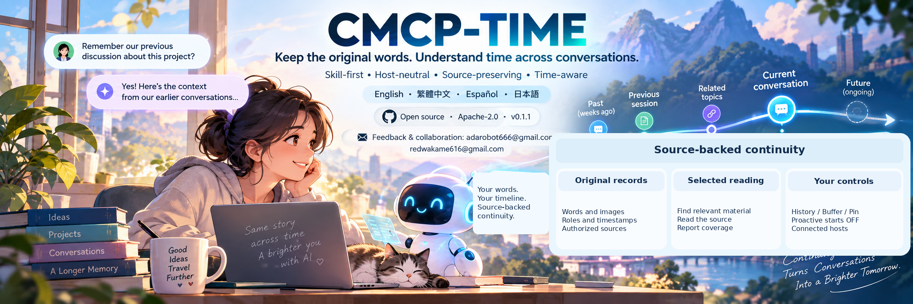
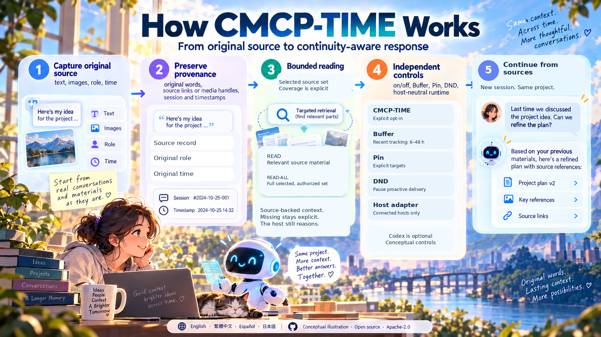

# CMCP-TIME

**English** · [繁體中文](README.zh-TW.md) · [Español](README.es.md) · [日本語](README.ja.md)



## Keep the original words. Give the next conversation a traceable starting point.

**A time-aware continuity skill for AI assistants.** CMCP-TIME preserves authorized original text, images, speaker roles and timestamps, then supplies relevant source material when the host needs to continue earlier work.

It also supports a useful distinction: what was planned, what changed, and what someone reported as completed. **Your model keeps doing the reasoning. CMCP-TIME provides traceable sources, time information and controlled continuity workflows.**

**v0.1.1 · Apache-2.0 · Created and maintained by [redwakame](https://github.com/redwakame)**

[Get started](#get-started) · [How it works](#how-it-works) · [Version differences](docs/version-comparison.md) · [Feedback and collaboration](#feedback-and-collaboration)

*These are conceptual illustrations, not screenshots or test transcripts. People, conversations and example timestamps are illustrative. The documented release scope defines the available capabilities.*

## Change one part without retelling the whole project

Yesterday you agreed on a plan. Today you say:

> “Move the delivery date to Friday. Keep the budget and the original approval conditions.”

A new conversation needs more than “there was a plan.” It needs the original conditions, this change and what remains in effect. CMCP-TIME is designed to let a connected host retrieve that material when needed instead of relying only on an untraceable summary.

This is an example of intended use, not a guaranteed model response. A model can still misunderstand material it has read; CMCP does not rewrite the host’s final answer.

| What you need | What CMCP-TIME provides |
|---|---|
| Find what was actually said | Authorized original records with roles, original timestamps and source relationships. |
| Understand what changed | Source-backed organization of plans, scoped revisions, reported facts and stated reasons. |
| Continue a long discussion or work across connected hosts | Source navigation followed by bounded reading, with missing pages, permissions and unread material made explicit. |
| Decide what to track and when not to be interrupted | Separate controls for saving, Buffer, Pin, quiet hours and proactive delivery. |

CMCP-TIME can coexist with native host memory. It is not a complete chat platform, and this release does not establish superiority over other products’ memory systems.

## Get started

Prepare **Node.js 22.16.0 or later** and npm, and choose a persistent installation location. Install the fixed version `0.1.1` from npm:

```sh
npm install --prefix ./cmcp-0.1.1 @redwakame-skill/cmcp-time@0.1.1
node ./cmcp-0.1.1/node_modules/@redwakame-skill/cmcp-time/bin/cmcp-time.mjs --version
node ./cmcp-0.1.1/node_modules/@redwakame-skill/cmcp-time/bin/cmcp-time.mjs setup --help
```

Then follow the [setup and update guide](docs/npm-installation.md) and select an authorized workspace. Use the interactive wizard in a terminal, or `--answers` for automation. **Piping a complete batch of interactive answers into the wizard is not supported.**

**Installing files does not attach a host.** Installation does not automatically import private chats, authorize model usage, enable proactive delivery or replace your daily deployment. Codex is optional. Do not point a permanent attachment at a temporary `npx` cache or storage whose persistence has not been established.

The GitHub and npm artifacts can differ in publication settings and documentation. Consult their respective release records for executable-content and source mapping. The same version number does not mean byte-identical archives; `latest` is not a fixed source identity.

## How it works



| Stage | Meaning |
|---|---|
| **1. Capture authorized sources** | A connected host supplies actual User/Assistant content, roles, timestamps and supported original images. |
| **2. Preserve records and provenance** | Keep original words rather than labeling a model’s paraphrase as the original; retain the identity and relationships needed for later checks. |
| **3. Read what this request needs** | Locate sources, then read them through the formal interface. `READ-ALL` means complete pagination of the selected, authorized set. It is not the whole database, a top-k result or proof that everything reached model context. |
| **4. Apply independent controls** | Saving, recent tracking, explicit targets and quiet hours have separate responsibilities. Access to information does not grant authority for external actions. |
| **5. Let the existing host continue** | Return source material and time information to the original model. When needed, organize source-backed current state while retaining uncertainty and coverage limits. |

**The Skill explains the workflow, the Runtime executes storage and reading, and an Adapter connects the host.** A Skill file alone cannot attach every ChatGPT or other platform conversation. Missing events, sources or permissions must remain visible.

## History, Buffer, Pin and quiet hours

| Component | Purpose and boundary |
|---|---|
| **History** | Preserves authorized original records for formal retrieval. Stored does not automatically mean currently readable. |
| **Buffer** | Tracks recent context. The default is 12 hours, adjustable from 6 to 48 hours; expiry or clearing does not delete History or independent Pins. |
| **Pin** | An explicitly selected tracking target. A Pin without a scheduled time does not automatically become a reminder. |
| **DND / quiet hours** | Controls interruptions from proactive delivery. **It is not the switch for pausing source storage.** |
| **Proactive delivery** | Starts OFF and remains subject to source authorization, destination, cancellation, deduplication and timing. A retained 60-second setting does not promise a message every minute. |

In an attached Harness Desktop, use `/cmcp help`, `/cmcp on`, `/cmcp off` and `/cmcp ui minimized`, `row` or `hidden`. **Hiding the interface does not disable CMCP.** These are host-specific entry points, not universal slash commands for every agent.

Without a UI, use the existing CLI, project or MCP entry. See [commands](docs/commands.md), [configuration](docs/configuration.md) and the [operating guide](docs/release-readiness.en.md).

## Which entry points have recorded verification?

This table describes the project’s recorded scope, not a blanket compatibility guarantee for every platform or version.

| Entry point | Recorded capability | Boundary |
|---|---|---|
| **DeepSeek Harness Desktop 0.2.0-rc.2 / SDK** | Text, original images, retrieval in new conversations, controls and explicit Pins; SDK continuity evidence is recorded separately. | Desktop and isolated SDK tests are distinct. No guarantee of round-the-clock or mobile delivery. |
| **Codex** | Skill/Hook, official app-server text handoff and scoped native compaction. | Explicit project/account routes, not automatic capture of arbitrary App chats. |
| **Hermes v2026.9.24 / 0.21.5** | Official headless lifecycle, native tools and scoped text continuity with Harness SDK. | The recorded DeepSeek route, not complete TUI/GUI verification. |
| **MCP stdio / Streamable HTTP** | Formal reading, media handles, scoped authorization, revocation and a persistent local service. | Local tests do not establish remote TLS, public deployment or platform approval. |

**Codex is optional; universal compatibility is not implied.** Version `0.1.1` adds no complete Dots, Muse or Grok Bot lifecycle integration. See the [capability and evidence matrix](docs/interop-capabilities.zh-TW.md).

## What changed from 0.1.0 to 0.1.1?


**0.1.0** established original-source and timestamp preservation, bounded reading, independent controls and the existing host entries. **0.1.1** incorporates the cumulative S1/S1-R1 work: separating plans from reported facts, preserving the scope and reasons of partial revisions, and improving setup, specified state-completion paths, proactive-status wording and release traceability.

`--answers` already existed. This increment improves noninteractive/EOF handling and setup without Codex. It does not add universal host integration, and it is not merely a new cover image.

[Full version comparison](docs/version-comparison.md) · [Original 0.1.1 release and limits](docs/release-0.1.1.md) · [0.1.0 history](docs/release-0.1.0.md)

<details>
<summary><strong>Release scope and known limits</strong></summary>

- Structural validity, source integrity, semantic correctness and execution authority are separate. `ready` is not an error-free guarantee.
- H4 maintenance verified specified reports and complete projection pagination in a new Session. The normal chain did not exercise the resolution branch; 13 fixed-source checks cover that branch separately. Additional selected source r8 did not reach the model. This is not all-selected `READ-ALL` or a replay of the original intermediate turn.
- Existing capacity limits in C27 cases 163/236 remain. The old `be087644…` receipt’s full-text preimage was not found. Those limitations were not removed to claim an all-green result.
- The 0.1.1 publication ran on Windows/Node 24.18.0, retaining the Node 22.16.0 minimum. Earlier or later scoped Linux checks do not certify all hosts. Four-language documentation is not four-language behavior certification.
- Vector retrieval, audio/video, broad cloud synchronization, multiple concurrent writers and a complete 24/7 agent are not all delivered in this version.

[Evidence and limits](docs/verification.md) · [Testing](docs/testing.md) · [Privacy](docs/privacy.md) · [Roadmap](docs/roadmap.md)

</details>

## Documentation, updates and project history

[Quick start](docs/quick-start.md) · [Installation and updates](docs/npm-installation.md) · [Operating guide](docs/release-readiness.en.md) · [MCP / Hermes](docs/interop.en.md) · [Contributing](CONTRIBUTING.md) · [Security reporting](SECURITY.md)

Back up according to the guide before updating or detaching. Program installation, CMCP History, native host history and credentials have separate responsibilities. Detachment is not complete data deletion.

CMCP-TIME is this project’s development line. [OpenClaw Continuity](https://github.com/redwakame/openclaw-continuity) and [cmcp](https://github.com/redwakame/cmcp) retain earlier code and their own licensing; they are not automatically interchangeable or migrated.

## Feedback and collaboration

I’m **redwakame**, the creator and maintainer of CMCP-TIME. I continue to develop the project and welcome real usage stories, reproducible issues, integration ideas, feedback and collaboration discussions.

**[adarobot666@gmail.com](mailto:adarobot666@gmail.com)**  
**[redwakame616@gmail.com](mailto:redwakame616@gmail.com)**

You can also open a [GitHub Issue](https://github.com/redwakame/CMCP-TIME/issues). Include the version, host and minimal reproduction steps; do not publish private conversations, keys or entire data directories. A Star is welcome when the project is useful to you.

## License

[Apache-2.0](LICENSE). Preserve attribution to **redwakame**, [NOTICE](NOTICE) and the [upstream license history](docs/license-provenance-v0.1.md). [CITATION.cff](CITATION.cff) provides citation information; it adds no requirement to advertise the author on every use.
