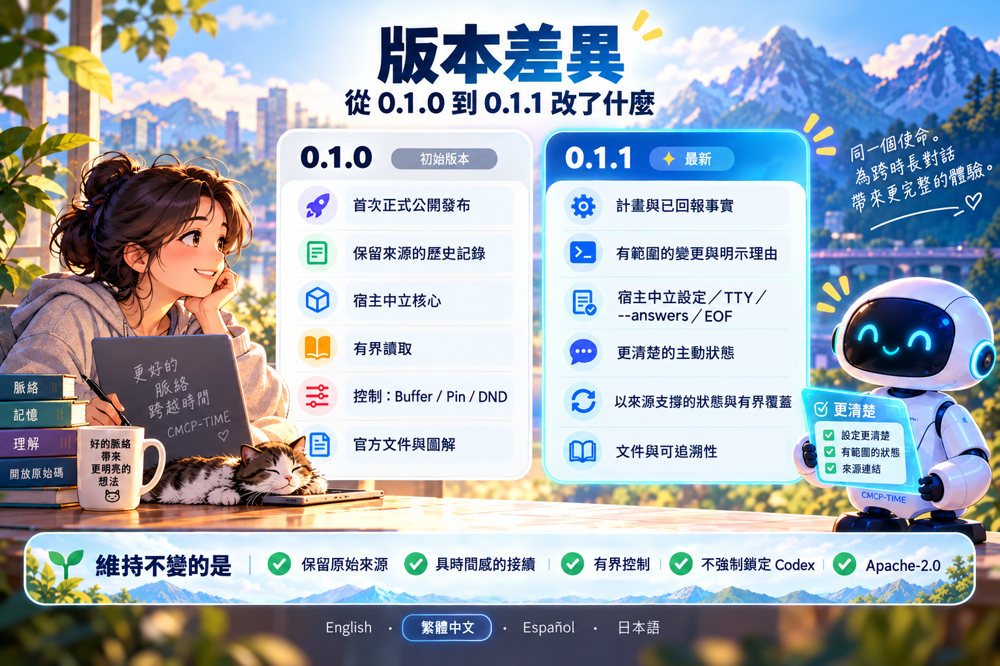

# CMCP-TIME

[English](README.md) · **繁體中文** · [Español](README.es.md) · [日本語](README.ja.md)


## 保留原話，讓下一次接續有跡可循。

**給 AI 助理使用的時間與對話接續技能。** CMCP-TIME 保留獲授權的原話、圖片、說話角色與時間，在需要時提供相關來源，協助助理接回先前的工作。

它也讓「原本打算做什麼」「後來改了哪裡」「使用者回報完成了什麼」可以分開整理。**你的模型繼續負責思考；CMCP-TIME 負責提供可查核的來源、時間與受控的接續流程。**

**v0.1.1 · Apache-2.0 · 原作者與維護者：[redwakame](https://github.com/redwakame)**

[開始使用](#開始使用) · [運作原理](#運作原理) · [版本差異](docs/version-comparison.zh-TW.md) · [交流與回饋](#交流與回饋)

*插圖是使用概念，不是實際介面或測試截圖。圖中的人物、對話與時間都是示意；可用能力以本文及版本文件為準。*

## 只改一部分，不必把整件事重新說一遍

昨天討論好一份計畫，今天你只說：

> 「把交期改成週五，預算和原本的審核條件不變。」

換到新對話後，真正需要接回的不只是「有一個計畫」，而是原來的內容、這次修改，以及仍然有效的條件。CMCP-TIME 的設計，是讓宿主按需找回這些來源，而不是只憑一段無法追溯的摘要繼續往下做。

這是用途示例，不是保證每次回答都正確。模型仍可能誤解已取得的原文；CMCP 不會替它改寫最後答案。

| 你需要的事情 | CMCP-TIME 的責任 |
|---|---|
| 找回當時怎麼說 | 保存獲授權的原文、角色、原時間及來源關係。 |
| 釐清哪些條件改了 | 按正式來源整理目前計畫、局部修訂、回報與明說的理由。 |
| 延續長對話或已接宿主的工作 | 先定位相關來源，再有界閱讀；缺頁、缺權限或未讀內容要明示。 |
| 決定何時追蹤、何時不要打擾 | 將保存、Buffer、Pin、勿擾與主動開關分開管理。 |

CMCP-TIME 可以與宿主原生記憶共存。它不是另一個完整聊天平台，也不是對所有 AI 工具原生記憶的優越性保證。

## 開始使用

準備 **Node.js 22.16.0 以上版本**與 npm，選擇持久的安裝位置。從 npm 安裝固定版本 `0.1.1`：

```sh
npm install --prefix ./cmcp-0.1.1 @redwakame-skill/cmcp-time@0.1.1
node ./cmcp-0.1.1/node_modules/@redwakame-skill/cmcp-time/bin/cmcp-time.mjs --version
node ./cmcp-0.1.1/node_modules/@redwakame-skill/cmcp-time/bin/cmcp-time.mjs setup --help
```

接著依[設定與更新指南](docs/npm-installation.md)選定獲授權的工作區。有終端機可使用互動精靈；自動化環境使用 `--answers`。**不支援把整批互動答案直接透過管線送入精靈。**

**安裝不等於接入宿主。** 它不會自動匯入私人聊天、取得模型使用授權、啟用主動派送，或替換你的日常部署。Codex 是選配，不是必要依賴。不要把永久接線指向短期 `npx` 快取或未確認會保留的暫存目錄。

GitHub 與 npm 成品的發布設定和文件可能不同，執行內容與來源映射請見各自發布紀錄。固定版本安裝不代表 GitHub 與 npm 的壓縮檔位元組相同；不要以 `latest` 代替固定來源。

## 運作原理


| 步驟 | 實際意思 |
|---|---|
| **1. 取得獲授權來源** | 透過已接好的宿主入口，取得真正的 User／Assistant 內容、角色、時間與支援的圖片原件。 |
| **2. 保留原件與來源關係** | 保存原話，不把模型的重述冒充原文；保留之後核對所需的身分與關係。 |
| **3. 只讀這次需要的內容** | 先定位，再正式閱讀。`READ-ALL` 指選定且獲授權集合的完整分頁，不是全庫、不只是搜尋前幾筆，也不表示全部已進模型脈絡。 |
| **4. 套用獨立控制** | 保存、近期追蹤、明確目標及勿擾各有責任；取得資料不等於取得外部操作授權。 |
| **5. 讓原宿主繼續工作** | 把已讀來源與時間交給原模型；需要時整理有來源的目前狀態，保留未解之處與覆蓋限制。 |

**Skill 說明使用方法，Runtime 執行保存與讀取，Adapter 接上宿主。** 只放入一份技能說明，不會自動接入所有 AI 宿主或平台的對話。缺少必要事件、來源或權限時，應明示限制。

## History、Buffer、Pin 與勿擾，分別管什麼？

| 功能 | 用途與界線 |
|---|---|
| **History** | 保存已授權的原話與來源，供之後正式回查。已保存不等於目前已具備回查資格。 |
| **Buffer** | 管理近期追蹤。預設 12 小時，可調整為 6–48 小時；到期或清除不刪除 History 與獨立 Pin。 |
| **Pin** | 使用者明確選定的追蹤目標；沒有指定時間，不自動成為提醒。 |
| **DND／勿擾** | 控制主動派送的打擾時段，**不是停止保存原文的開關**。 |
| **主動派送** | 首次預設關閉，仍受來源授權、目標、取消、去重及有效時間控制；保留的 60 秒欄位不代表每分鐘會發送。 |

在已接好的 Harness Desktop，可使用 `/cmcp help`、`/cmcp on`、`/cmcp off`，以及 `/cmcp ui minimized`、`row`、`hidden` 選擇顯示方式。**隱藏介面不等於停用。** 這些是該宿主的入口，不宣稱所有代理都使用同一組斜線指令。

沒有 UI 時，使用既有 CLI／專案或 MCP 入口。詳見[命令](docs/commands.md)、[設定](docs/configuration.md)與[正式操作指南](docs/release-readiness.zh-TW.md)。

## 哪些入口已有驗收紀錄？

下表描述本專案已記錄的範圍，不是所有版本或所有平台的相容性保證。

| 入口 | 已記錄能力 | 仍須注意 |
|---|---|---|
| **DeepSeek Harness Desktop 0.2.0-rc.2／SDK** | 文字、圖片原件、新對話回查、控制與明確 Pin；SDK 接續證據另列。 | Desktop 與隔離 SDK 不是同一種驗收，不保證全天候或手機送達。 |
| **Codex** | Skill／Hook、官方 app-server 的文字交接與限定原生壓縮。 | 明示專案與帳戶路線；不是任意 App 對話自動擷取。 |
| **Hermes v2026.9.24／0.21.5** | 官方無 UI 生命週期、原生工具，與 Harness SDK 的限定文字接續。 | 記錄中的 DeepSeek 路線；不等於 TUI／GUI 全面驗證。 |
| **MCP stdio／Streamable HTTP** | 正式閱讀、媒體 handle、授權範圍、撤回與持久本機服務。 | 本機測試不等於遠端 TLS、公網或平台審核完成。 |

**不強制 Codex，不等於所有宿主已自動相容。** `0.1.1` 未新增 Dots、Muse、Grok Bot 的完整生命週期整合。詳見[能力與證據矩陣](docs/interop-capabilities.zh-TW.md)。

## 0.1.0 到 0.1.1，改了什麼？



**0.1.0** 建立原文與時間保存、有界讀取、獨立控制及既有宿主入口。**0.1.1** 納入 S1／S1-R1 累積改進：分開計畫與事實回報、保留局部修訂的適用範圍及理由，並改善初始化、指定狀態的完成路徑、主動狀態說明與發布資料一致性。

`--answers` 原本就存在；此次改善的是非互動／EOF 處理及沒有 Codex 時的初始化說明。這不是新增全平台接線，也不是只有換封面。

[閱讀完整版本差異](docs/version-comparison.zh-TW.md) · [0.1.1 原始發布與限制](docs/release-0.1.1.md) · [0.1.0 歷史](docs/release-0.1.0.md)

<details>
<summary><strong>發布範圍與已知限制</strong></summary>

- 機械結構、來源一致、語意判斷及執行授權是不同層次。`ready` 不是零錯誤保證。
- H4 指定回報與完整投影分頁的維護結果來自新 Session。正常鏈未走 resolution 分支；該分支另有 13 項固定原件測試。額外選取的 r8 未進模型，不宣稱全選取 `READ-ALL` 或原中間回合重演。
- C27 163／236 的既有容量限制保留；舊回執 `be087644…` 正文前像未找到。沒有刪除這些限制來宣稱全綠。
- 0.1.1 發布流程實跑 Windows／Node 24.18.0；最低 Node 聲明為 22.16.0。既有或後續局部 Linux 核對不等於所有宿主全面認證。四語文件不等於四語行為皆已驗收。
- 向量、音訊／影片、全面雲端同步、多人並行 writer 與完整 24/7 代理，均非本版全部完成的能力。

[證據與限制](docs/verification.md) · [測試說明](docs/testing.md) · [隱私](docs/privacy.md) · [後續方向](docs/roadmap.md)

</details>

## 文件、更新與專案沿革

[快速開始](docs/quick-start.md) · [安裝與更新](docs/npm-installation.md) · [繁中操作指南](docs/release-readiness.zh-TW.md) · [MCP／Hermes](docs/interop.zh-TW.md) · [貢獻方式](CONTRIBUTING.md) · [安全回報](SECURITY.md)

升級或解除接線前，先依指南備份。程式安裝、CMCP History、宿主原生歷史與憑證是不同責任；解除接線不等於清除全部資料。

CMCP-TIME 是此專案的開發主線。[OpenClaw Continuity](https://github.com/redwakame/openclaw-continuity) 與 [cmcp](https://github.com/redwakame/cmcp) 保留早期程式與各自授權，不表示可直接互換或自動遷移。

## 交流與回饋

我是 **redwakame**，會持續研發與維護 CMCP-TIME。歡迎分享使用情境、遇到的問題、整合想法及實際效果，也歡迎討論合作。

**[adarobot666@gmail.com](mailto:adarobot666@gmail.com)**  
**[redwakame616@gmail.com](mailto:redwakame616@gmail.com)**

可重現問題也可以提交到 [GitHub Issues](https://github.com/redwakame/CMCP-TIME/issues)。請附版本、宿主與最小重現步驟；不要公開私人聊天、金鑰或完整資料目錄。覺得專案有幫助，也歡迎給顆 Star。

## 授權

[Apache-2.0](LICENSE)。保留原作者 **redwakame**、[NOTICE](NOTICE) 與[上游授權沿革](docs/license-provenance-v0.1.md)。[CITATION.cff](CITATION.cff) 提供引用資訊；不新增每次使用都必須宣傳作者的條款。
