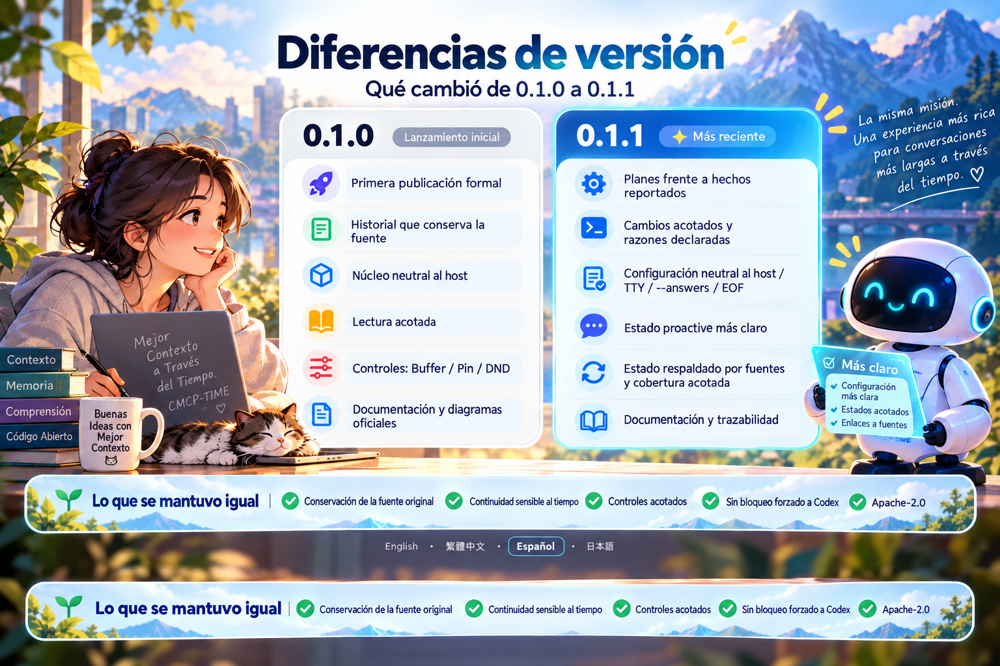

# Diferencias entre versiones: 0.1.0 → 0.1.1

[English](version-comparison.md) · [繁體中文](version-comparison.zh-TW.md) · **Español** · [日本語](version-comparison.ja.md)  
[Volver a la portada](../README.es.md)

**0.1.1 no es solo una actualización de las instrucciones de instalación.** Reúne mejoras acumuladas de continuidad basada en fuentes y cuatro correcciones de mantenimiento. La tabla describe comportamientos útiles; los detalles de ingeniería permanecen en la documentación original.

| Área | Base de 0.1.0 | Mejora en 0.1.1 |
|---|---|---|
| Fuentes y tiempo | Originales, roles, fechas, relaciones entre fuentes y lectura acotada. | Se conserva la base; la organización derivada no sustituye a los originales. |
| Planes e informes | Entradas de tiempo, fuentes y continuidad existentes. | S1/S1-R1 separa los planes actuales de los informes del usuario, sin convertir una intención en un hecho ya ocurrido. |
| Cambios delimitados y razones | Ya existía recuperación de fuentes, no toda la representación y verificación posterior. | Se separan las condiciones y los objetivos explícitos: modificar una parte, conservar el resto y distinguir nuevas razones, prioridades y retiradas expresas. |
| Configuración | Ya existían el asistente interactivo y `--answers`. | Manejo explícito de no TTY/EOF. Las tuberías por lotes siguen sin admitirse; usar `--answers`. Sin Codex seleccionado no se busca ni se solicita iniciarlo. |
| Estado bajo demanda | Bases de fuentes y controles. | Mejor información de corrección y paginación completa para casos especificados que mezclan informes e instrucciones, conservando lagunas y ambigüedades reales. |
| Estado proactivo | Desactivado al inicio, con Buffer/Pin/silencio y permisos. | Se distinguen configuración, ejecutor efectivo, conexión de entrega y candidatos. No se añade una política proactiva general. |
| Publicación y documentos | Documentación en cuatro idiomas, diagramas y GitHub/npm 0.1.0 formal. | GitHub 0.1.1 formal, fuentes acumuladas y trazabilidad corregida. npm se verifica como canal independiente. |

## Principios que se mantienen

El estado derivado no reemplaza los originales. El modelo del asistente sigue razonando. Codex es opcional. Guardado, seguimiento, silencio y autorización de acciones externas siguen separados. Se mantienen Apache-2.0, la atribución a redwakame y los avisos de origen.

## Un resultado acotado no significa que todo esté terminado

H4 verificó los tres informes especificados y la paginación completa de la proyección en una Session nueva. La cadena normal no recorrió la rama de resolución; hay 13 comprobaciones separadas con fuentes fijas. r8 no llegó al modelo, por lo que no es READ-ALL de todo lo seleccionado. Permanecen los límites C27 163/236 y la falta del texto histórico previo de un recibo.

No se añaden ciclos completos de Dots/Muse/Grok Bot, despliegue general en la nube, audio/vídeo, búsqueda vectorial ni un agente completo 24/7. Tampoco se demuestra superioridad frente a la memoria nativa. Cuatro idiomas de documentación no certifican el comportamiento del modelo en los cuatro.

## Obtener y actualizar

Usa la [versión fija de npm indicada en la portada](../README.es.md#primeros-pasos) o la [guía de instalación](npm-installation.md), en directorios persistentes. Haz una copia antes de actualizar; no borres History. Instalar el paquete y actualizar la conexión del asistente son operaciones distintas.

Los artefactos de GitHub y npm pueden diferir en configuración de publicación y documentación. Consulta sus respectivos registros para comprobar el contenido ejecutable y la correspondencia de fuentes. Un mismo número de versión no implica archivos idénticos; `latest` no identifica una fuente inmutable.

[Publicación original 0.1.1 y límites](release-0.1.1.md) · [Historial 0.1.0](release-0.1.0.md) · [Pruebas](testing.md) · [Hoja de ruta](roadmap.md)

Comentarios y colaboración: [adarobot666@gmail.com](mailto:adarobot666@gmail.com) · [redwakame616@gmail.com](mailto:redwakame616@gmail.com)
