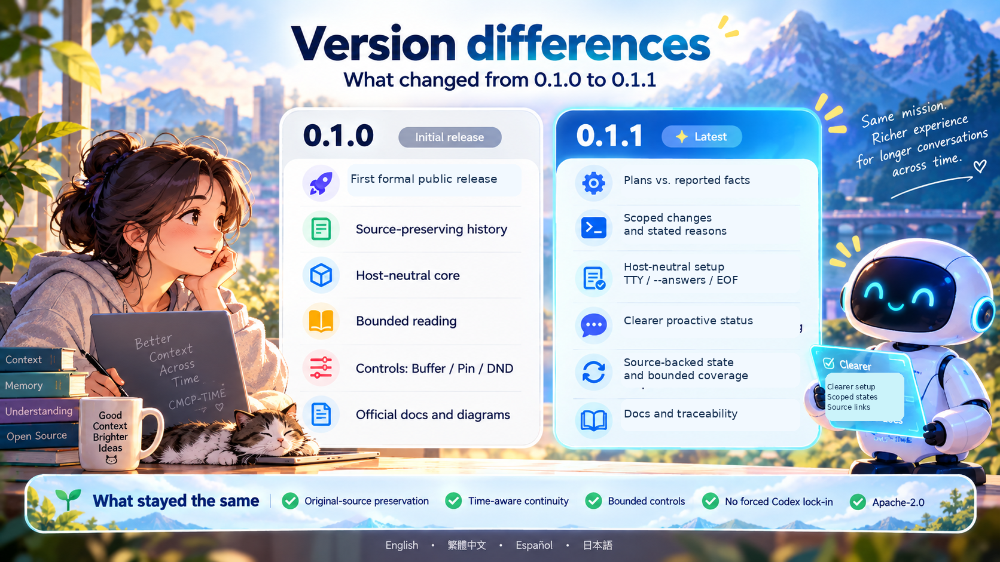

# バージョンの違い：0.1.0 → 0.1.1

[English](version-comparison.md) · [繁體中文](version-comparison.zh-TW.md) · [Español](version-comparison.es.md) · **日本語**  
[日本語のトップへ](../README.ja.md)

**0.1.1 はインストール説明だけの更新ではありません。** 出典を保つ会話継続の累積改善と、四つの保守修正を含みます。次の表は利用者に関係する違いをまとめたもので、工程の詳細は元の公開資料に残しています。

| 項目 | 0.1.0 の基礎 | 0.1.1 の追加・改善 |
|---|---|---|
| 原文と時間 | 原本、役割、時刻、出典の関係、範囲を限定した読み取り。 | 基礎を維持し、新しい派生整理で原本を置き換えません。 |
| 計画と報告 | 時間・出典・引き継ぎの入口。 | S1／S1-R1 の累積成果で、現在の計画と利用者の報告を分離。意図を、すでに起きた事実として扱いません。 |
| 部分変更と理由 | 出典の再読は既存ですが、後の表現・検証がすべて済んでいたわけではありません。 | 条件と明示された対象を分け、指定部分だけを更新し、残りを保持。理由の追加、優先順位、明示的な撤回を区別します。 |
| 初期設定 | 対話式ウィザードと `--answers` は既存です。 | 非 TTY／EOF を明確に処理。回答の一括パイプ入力は非対応で `--answers` を使います。Codex を選ばなければ検出・起動要求を行いません。 |
| 要求時の状態整理 | 出典と制御の基礎。 | 回報と指示が混在する指定例で、修正用の情報と結果の全ページ取得を改善。未読や本当の曖昧さは残します。 |
| 能動送信の状態 | 初期 OFF、Buffer／Pin／通知抑制と権限制御。 | 設定値、実際の実行器、送信接続、対象候補を分けます。一般的な能動送信方針は追加しません。 |
| 公開と文書 | 四言語文書、図解、正式 GitHub／npm 0.1.0。 | 正式 GitHub 0.1.1、累積ソース、公開物の追跡性を改善。npm は別の配布経路として確認します。 |

## 変わらない原則

派生状態は原文の代わりではありません。推論はホストのモデルが行い、Codex は任意です。保存、追跡、通知抑制、外部実行権限を分けます。Apache-2.0、redwakame の表記、上流の通知を保持します。

## 限定的な成功を全面完了とはしない

H4 は新しい Session で三つの指定報告と投影結果の全ページを確認しました。通常経路は resolution 分岐を通らず、その部分は 13 項目の固定原文試験で別に確認しています。追加の r8 はモデルに届いていないため、全選択資料の READ-ALL ではありません。C27 163／236 の容量制限と、古い受領記録の変更前本文が見つからない制限も残ります。

Dots／Muse／Grok Bot の全ライフサイクル、広範なクラウド展開、音声／動画、ベクトル検索、完全な 24/7 エージェントは追加していません。標準メモリより優れているとの実証でもありません。四言語の文書は、四言語のモデル動作認証ではありません。

## 取得と更新

[トップページの固定 npm バージョン](../README.ja.md#使い始める)または[インストールガイド](npm-installation.md)を使い、永続的な場所を選びます。更新前にバックアップし、History は削除しないでください。パッケージの導入とホスト接続の更新は別の操作です。

GitHub と npm の配布物は公開設定や文書が異なる場合があります。実行内容とソースの対応は、それぞれの公開記録で確認してください。同じ版番号でも圧縮ファイルのバイト列が同じとは限らず、`latest` は固定された出典識別子ではありません。

[0.1.1 の元の公開説明と制限](release-0.1.1.md) · [0.1.0 の履歴](release-0.1.0.md) · [テスト](testing.md) · [ロードマップ](roadmap.md)

ご意見・協力：[adarobot666@gmail.com](mailto:adarobot666@gmail.com) · [redwakame616@gmail.com](mailto:redwakame616@gmail.com)
